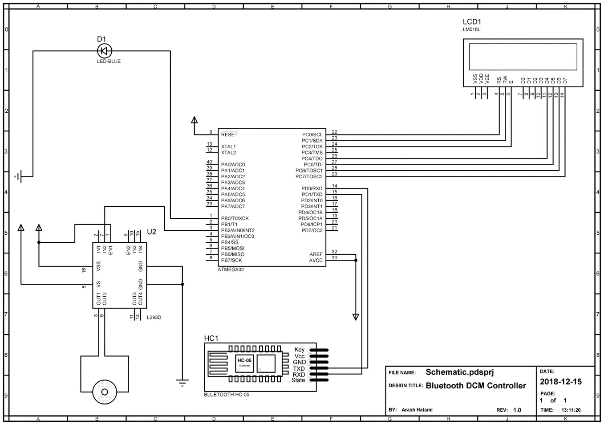
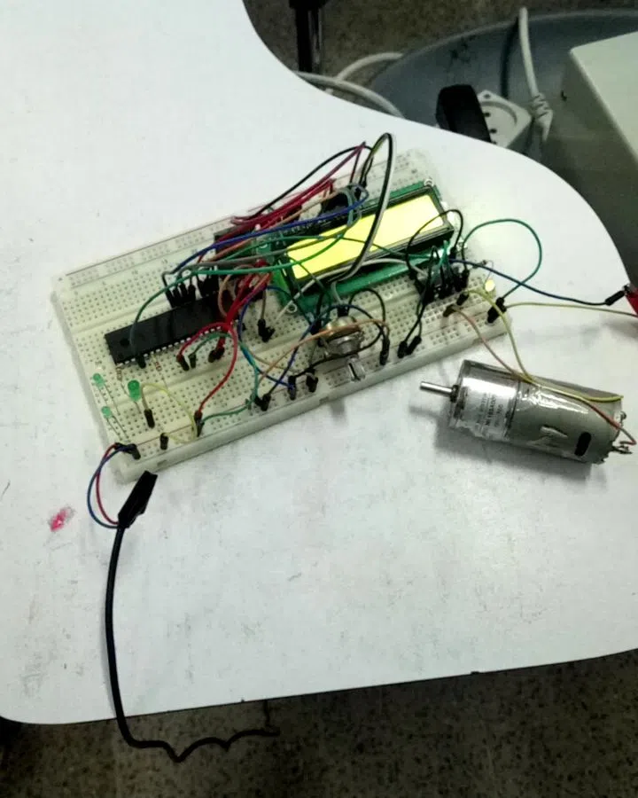
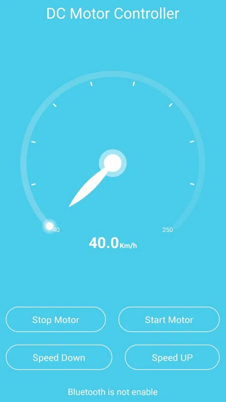

این پروژه در قالب یکی از اجزای پروژه IOT بزرگتر طراحی و توسعه داده شد. در ابتدا یک کار ساده دانشجویی بود که در سال 1399 واگذار شد و با طرح دیگری ادغام شد. اولویت این پروژه پیاده سازی کامل بود و به همین دلیل از برد های الکترونیکی آماده مانند آردوینو و رزبری پای استفاده نشد.

در نمونه اولیه تمامی قطعات روی برد بورد اسمبل شد و پس از واگذاری به صورت حرفه ای تر روی بورد های چندلایه پیاده سازی شد. اجزای تشکیل دهنده سیستم :

- موتور DC
- ماژول بلوتوث HC05
- درایور L293D
- اپلیکیشن اندروید
- نمایشگر LM016L
- میکروکنترلر ATMega32

در نسخه اولیه اپلیکیشن اندرویدی از طریق بلوتوث به ماژول HC05 متصل شده و دستورات کنترل موتور مانند افزایش/کاهش سرعت و خاموش روشن را به میکروکنترلر ارسال می کند. میکروکنترلر با استفاده از درایور موتور ، ادامه کار را انجام داده و با PWM سرعت موتور را کنترل خواهد کرد.

## شماتیک مدار

## نسخه اولیه

## اپلیکیشن اندروید

## ویدئو تست نسخه اولیه

<video controls preload="none" playsinline width="500" height="960" poster="/videos/bluetooth-dc-motor-remote_dcm_5.jpg">
  <source src="/videos/bluetooth-dc-motor-remote_dcm_5.webm" type="video/webm" />
</video>
