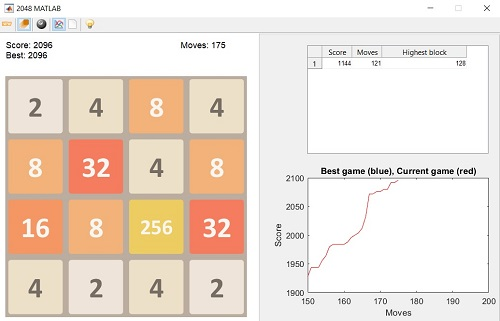

سایرولی این بازی را به عنوان پروژه آخر هفته و تنها در ۲ روز طراحی کرد و بازی در کمتر از ۱ هفته ، ۴ میلیون بیننده داشت. مبنای بازی بر حرکت خانه‌های با اعداد مشابه ( ضرایب عدد ۲ ) به سمت هم و سرانجام دست ‌یابی به عدد «۲۰۴۸» است. این بازی نوعی از پازل‌های کشویی می‌باشد و شباهت زیادی به بازی ]سه‌تایی‌ها()[ که ۱ ماه قبل از آن منتشر شد دارد.



## اجرا

ابتدا پروژه را Clone کنید :

```sh
gh repo clone hatamiarash7/Matlab2048
```

سپس پروژه را در متلب باز کرده و فایل `play2048.m` را اجرا نمایید
