این پروژه در سال 1398 به سفارش [دانشگاه ملی ملایر](https://malayeru.ac.ir/portal/home/) طراحی شد. با توجه به سیستم سنتی انبار داری موجود در آن زمان ، برنامه ریزی هایی انجام شد تا ساز و کار به صورت دیجیتالی انجام شده و سیستم کاغذی از بین برود. روند انبارداری شامل ساختمان ها ، طبقات ، اتاق ها ، مسئولین و کالاهای مختلف بود که ثبت و مدیریت و بازرسی هرکدام از آن ها با توجه به گسترش فضای فیزیکی دانشگاه کار دشوار و طولانی بود.

این پروژه شامل یک بخش مدیریتی بوده که کلیه اطلاعات در آن وارد می شوند. اعم از ساختمان ها و طبقات و غیره. سپس روند تخصیص و مدیریت کالا ها از طریق اپلیکیشن موبایل صورت پذیرفته تا متصدی از سرعت عمل و دقت بالاتری بهره مند شود.

## تصاویر

> داده های موجود در این تصاویر آزمایشی هستند

_صفحه ورود_

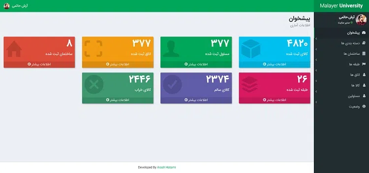
_صفحه اصلی پنل مدیریت_

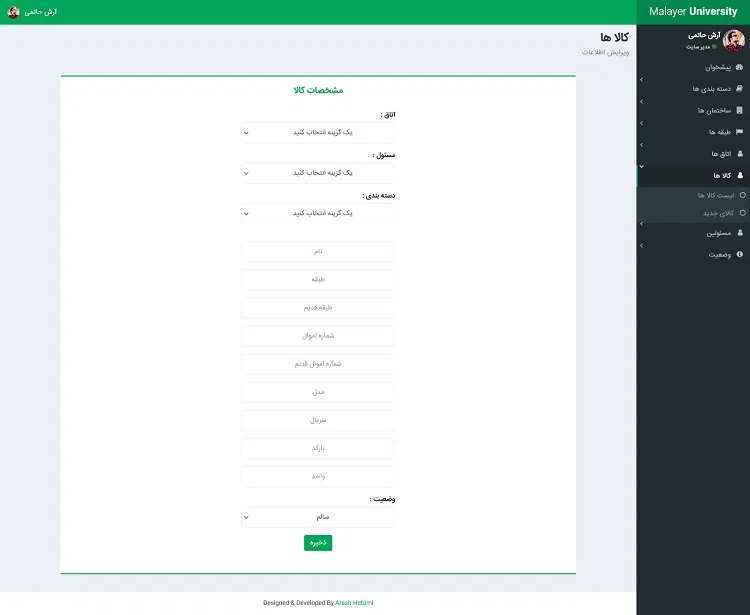
_صفحات مدیریت اطلاعات - ثبت کالا_

### اپلیکیشن اندروید

> داده های موجود در این تصاویر آزمایشی هستند

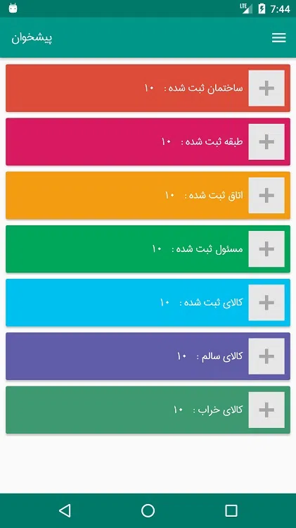
_صفحه اصلی_

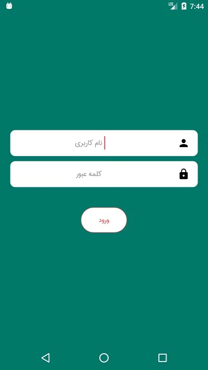
_ورود به حساب کاربری_

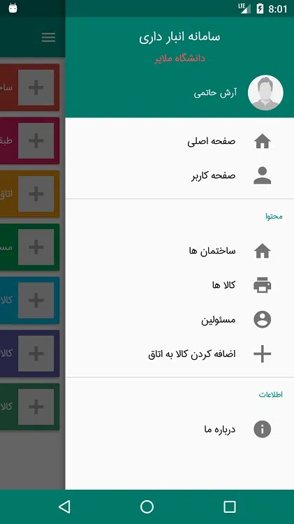
_منو_

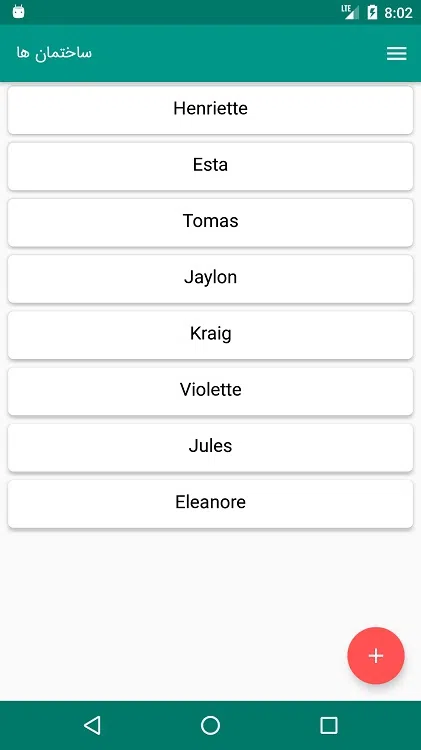
_لیست ساختمان ها_

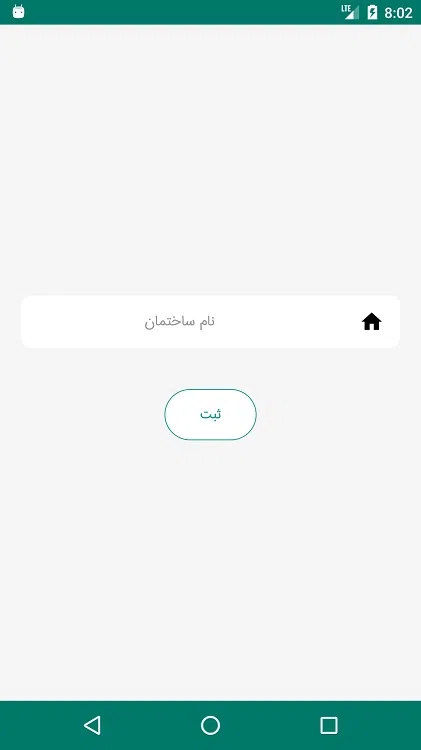
_ثبت ساختمان جدید_

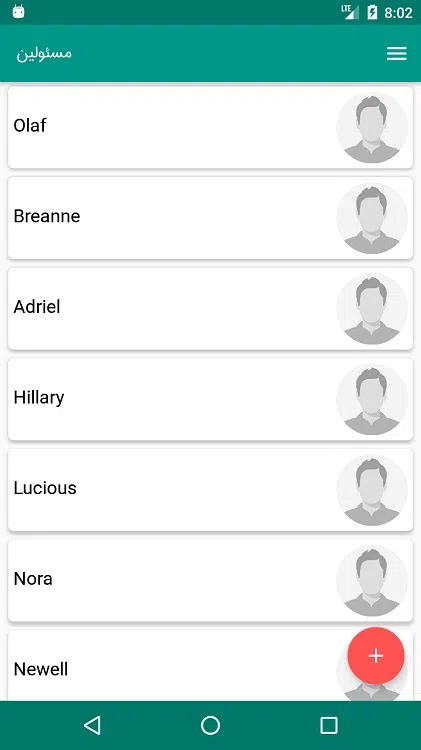
_لیست مسئولین_

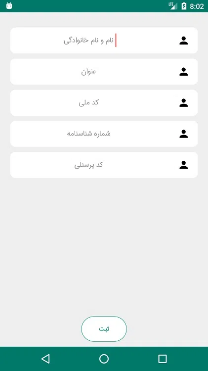
_ثبت مسئول جدید_

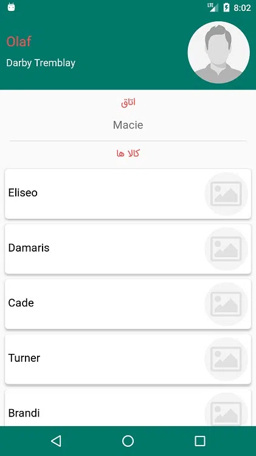
_مشخصات مسئول - شامل ساختمان ، طبقه ، اتاق و لیست کالا ها_

### تخصیص کالا

روند اضافه کردن کالا به اتاق به این شکل است که هر اتاق یک بارکد اختصاصی داشته که در قسمت ورودی نصب می شود. و مسلما هر کالایی نیز بارکد تعریف شده ی خود را دارد. با اسکن این دو بارکد می توان به راحتی کالا را به ان اتاق اضافه کرد.

_اضافه کردن کالا به اتاق_

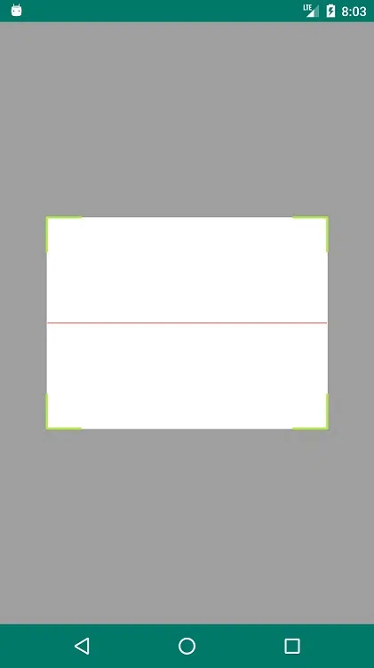
_اسکن بارکد_
