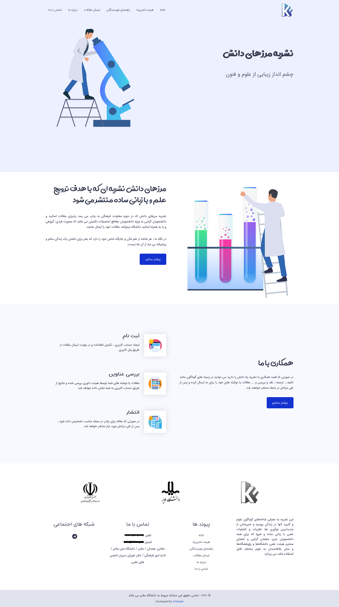
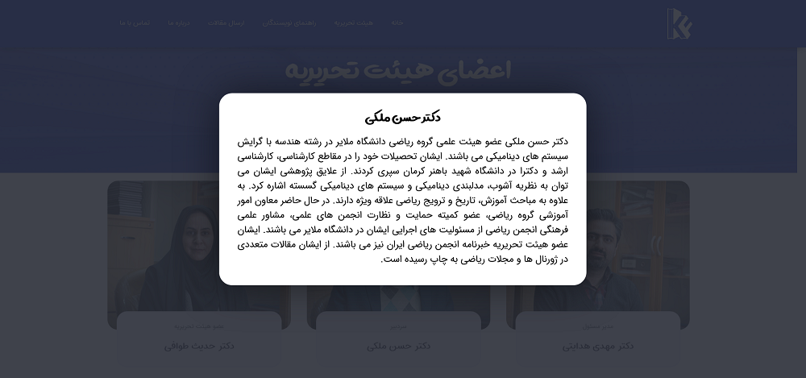
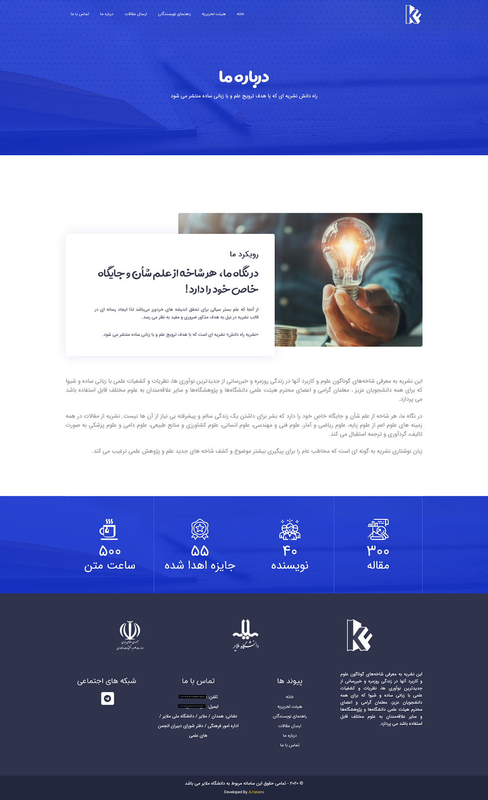
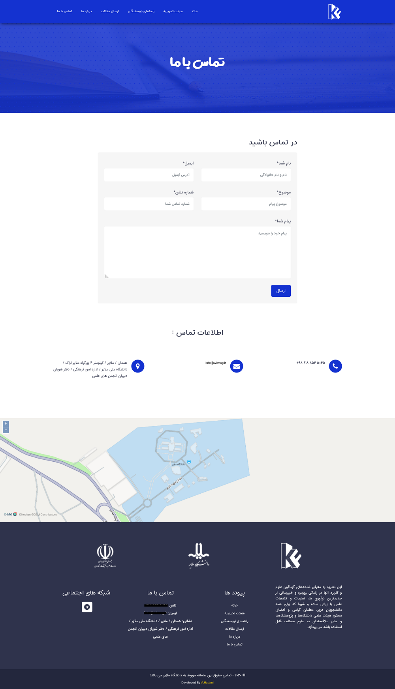

نشریه مرزهای دانش که در حوزه معاونت فرهنگی دانشگاه ملایر به چاپ می رسد پذیرای مقالات اساتید و دانشجویان گرامی به ویژه دانشجویان مقاطع تحصیلات تکمیلی می باشد که به صورت فردی و گروهی می توانند مقالات خود را ارسال نمایند.

## تصاویر

_صفحه اصلی_

_صفحه اعضای هیئت تحریریه_

_پنجره نمایش اطلاعات عضو_

_صفحه درباره ما_

_صفحه تماس با ما_
